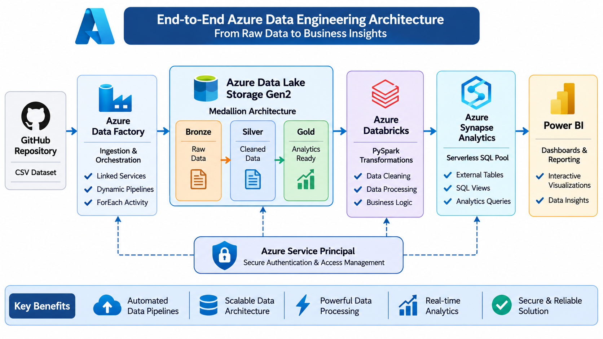

# End-to-End Azure Data Engineering Project

An end-to-end cloud data engineering project demonstrating data ingestion, storage, transformation, querying, and visualization using Microsoft Azure services.

## Project Overview

This project implements an automated data engineering workflow using Azure Data Factory, Azure Data Lake Storage Gen2, Azure Databricks, Azure Synapse Analytics, and Power BI.

CSV datasets are ingested from GitHub, stored in Azure Data Lake Storage Gen2, processed using PySpark, queried through Synapse Serverless SQL Pool, and visualized using Power BI.

## Architecture Diagram

## Technology Stack

| Technology | Purpose |
|---|---|
| GitHub | Source datasets |
| Azure Data Factory | Data ingestion and orchestration |
| Azure Data Lake Storage Gen2 | Centralized data storage |
| Azure Databricks | Data processing and transformation |
| PySpark | Distributed data processing |
| Azure Synapse Analytics | Serverless SQL querying |
| SQL | Data querying and views |
| Power BI | Data visualization and reporting |

## Project Workflow

1. **Data Source:** CSV datasets are maintained in GitHub.
2. **Data Ingestion:** Azure Data Factory retrieves datasets using dynamic pipelines and ForEach activities.
3. **Data Storage:** Raw datasets are stored in ADLS Gen2.
4. **Data Transformation:** Azure Databricks and PySpark process and transform the data.
5. **Medallion Architecture:** Data is organized into Bronze, Silver, and Gold layers.
6. **Data Querying:** Synapse Serverless SQL Pool queries the data using OPENROWSET, external tables, and SQL views.
7. **Data Visualization:** Power BI presents analytical insights through interactive dashboards.

## Key Features

- Automated data ingestion using Azure Data Factory.
- Dynamic pipelines with ForEach activity.
- Medallion Architecture implementation.
- Data cleaning and transformation using PySpark.
- Serverless SQL querying using Azure Synapse Analytics.
- External tables and SQL views.
- Power BI dashboard development.
- Service Principal authentication.

## Project Documentation

Explore the individual implementation details:

- [Azure Data Factory](azure-data-factory/README.md)
- [Azure Data Lake Storage Gen2](azure-data-lake/README.md)
- [Azure Databricks and PySpark](azure-databricks/README.md)
- [Azure Synapse Analytics](azure-synapse/README.md)
- [Power BI Dashboard](power-bi/README.md)

## PySpark Notebook

[View the complete PySpark data transformation notebook](azure-databricks/notebooks/data-transformation.ipynb).

## Project Screenshots

Explore the implementation screenshots:

- [Azure Data Factory](screenshots/data-factory/)
- [Azure Data Lake Storage Gen2](screenshots/storage/)
- [Azure Databricks](screenshots/databricks/)
- [Azure Synapse Analytics](screenshots/synapse/)
- [Power BI](screenshots/power-bi/)

## Key Learnings

- Building end-to-end data engineering pipelines on Azure.
- Automating data ingestion and orchestration.
- Implementing Medallion Architecture.
- Processing data using Apache Spark and PySpark.
- Querying data using Azure Synapse Serverless SQL Pool.
- Building interactive analytical dashboards using Power BI.
- Working with cloud authentication and security.

## Author

**Darshil Nakrani**

GitHub: [darshil-nakrani](https://github.com/darshil-nakrani)
