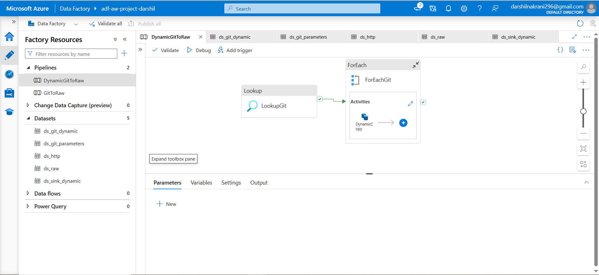
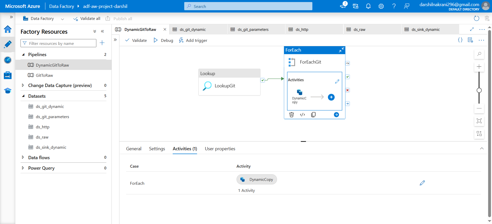
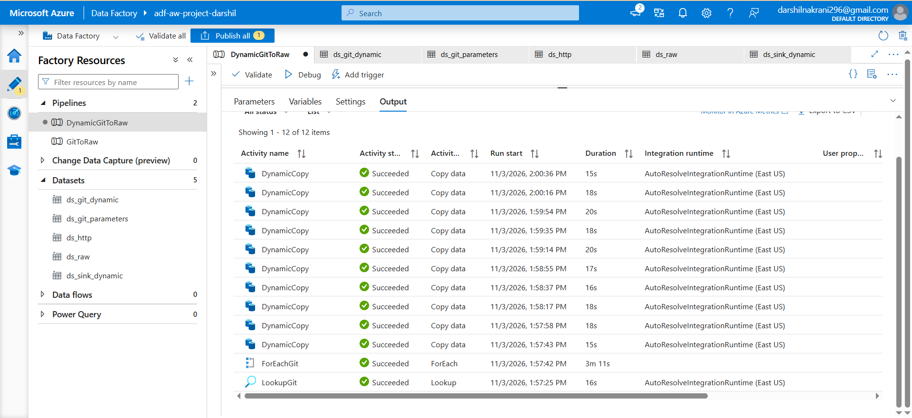
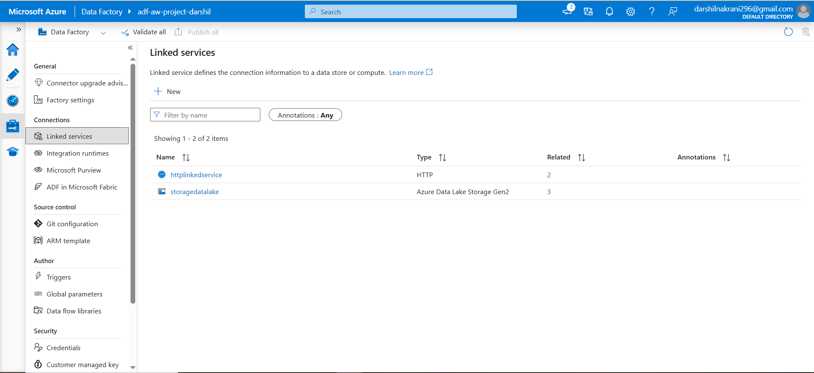

# Azure Data Factory

## Overview
Azure Data Factory (ADF) is used to automate and orchestrate the data ingestion process from GitHub into Azure Data Lake Storage Gen2.

## Implementation

The following ADF features were used in this project:

- **Linked Services:** Configured connections to the required data sources and Azure resources.
- **Dynamic Pipelines:** Created reusable pipelines to handle multiple datasets.
- **ForEach Activity:** Used to iterate over multiple datasets and automate the ingestion process.
- **Data Ingestion:** Retrieved CSV datasets from GitHub and transferred them to Azure Data Lake Storage Gen2.

## Key Concepts Learned

- Data Factory pipelines and activities
- Linked services and datasets
- Dynamic pipeline parameters
- ForEach activity
- Automated data ingestion and orchestration

## Outcome

Successfully implemented an automated and reusable data ingestion workflow using Azure Data Factory.

## Screenshots

### 1. Pipeline Overview

### 2. ForEach Activity

### 3. Pipeline Execution

### 4. Linked Services

