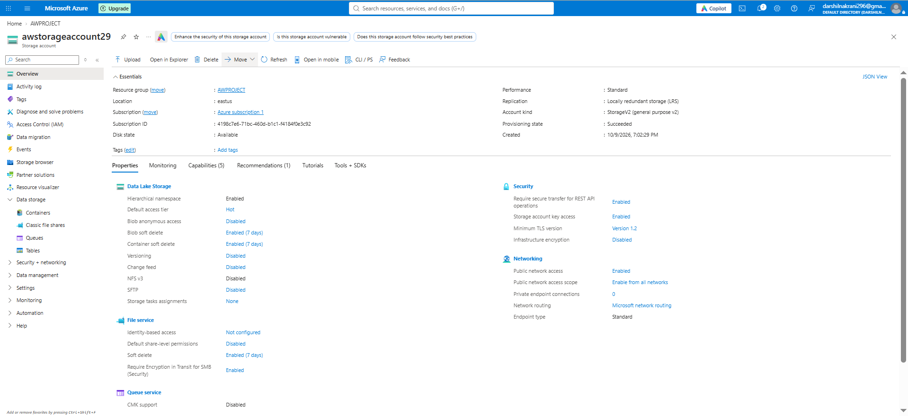
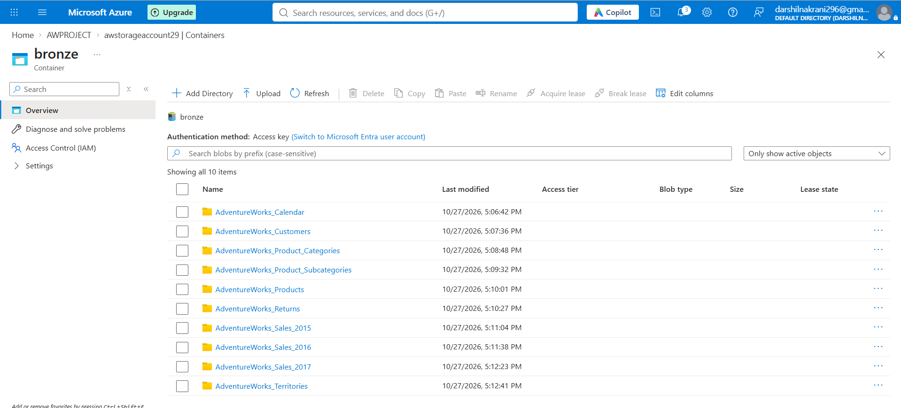
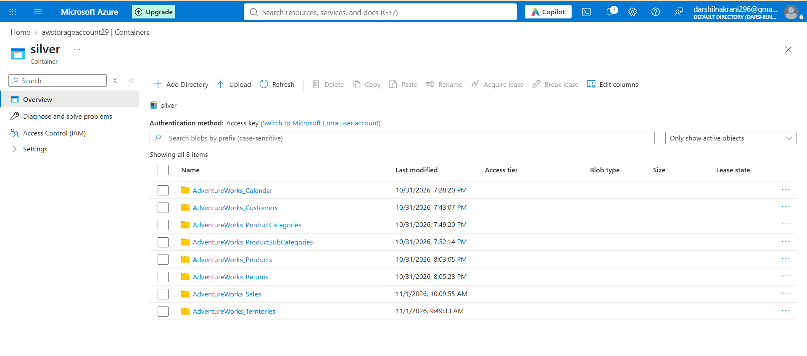
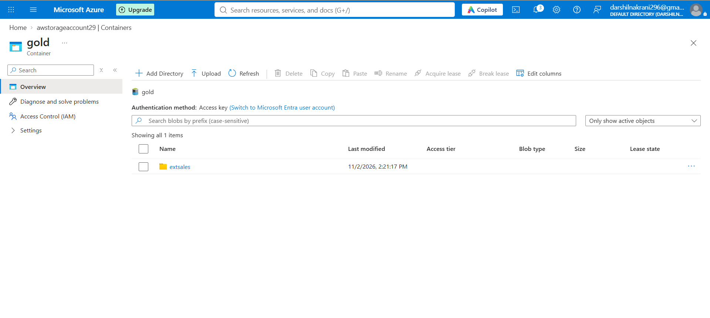

# Azure Data Lake Storage Gen2

## Overview

Azure Data Lake Storage Gen2 (ADLS Gen2) is used as the central storage layer of this end-to-end data engineering project.

It stores datasets at different stages of processing using the Medallion Architecture.

## Medallion Architecture

The data lake is organized into three layers:

### 1. Bronze Layer
- Stores raw data ingested from GitHub.
- Preserves the original source data.
- Acts as the initial landing zone for datasets.

### 2. Silver Layer
- Stores cleaned and transformed data.
- Contains processed datasets after data quality and transformation operations.
- Prepares data for further analysis.

### 3. Gold Layer
- Stores analytics-ready data.
- Contains refined datasets for reporting and business analysis.
- Serves as a data source for downstream analytics.

## Key Concepts Learned

- Azure Data Lake Storage Gen2
- Data lake organization
- Medallion Architecture
- Bronze, Silver, and Gold layers
- Integration with Azure Data Factory and Azure Databricks

## Outcome

Implemented a structured data lake using the Medallion Architecture to organize raw, cleaned, and analytics-ready datasets.

## Screenshots

### 1. Storage Account Overview

### 2. Bronze Layer

### 3. Silver Layer

### 4. Gold Layer

