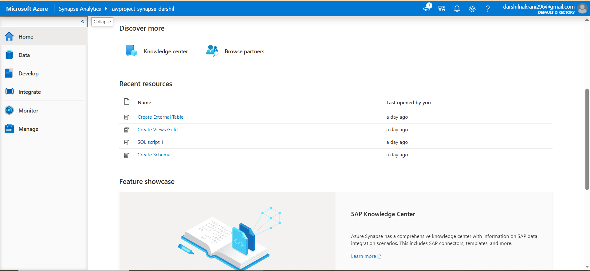
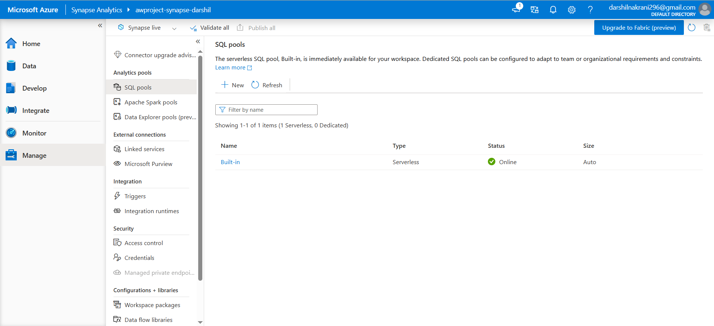
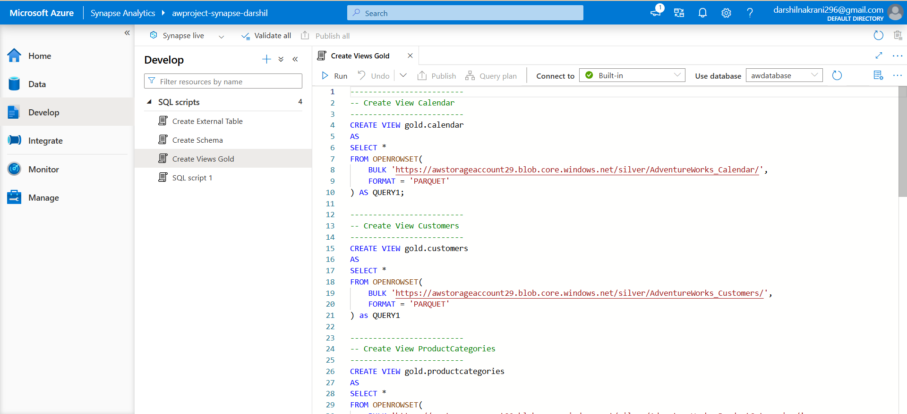
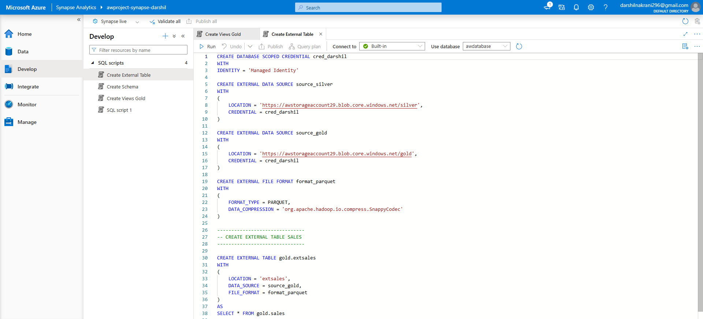

# Azure Synapse Analytics

## Overview

Azure Synapse Analytics Serverless SQL Pool is used to query and analyze data stored in Azure Data Lake Storage Gen2 without managing dedicated SQL infrastructure.

## Implementation

The following features were implemented:

- **Serverless SQL Pool:** Used to run SQL queries directly on data stored in the data lake.
- **OPENROWSET:** Used to read and query files directly from Azure Data Lake Storage.
- **External Tables:** Created external table definitions to access data stored in the data lake.
- **SQL Views:** Created views to simplify data access and organize SQL queries.
- **Data Analysis:** Queried processed datasets for analytical purposes.

## Key Concepts Learned

- Azure Synapse Analytics workspace
- Serverless SQL Pool
- OPENROWSET
- External data sources and file formats
- External tables
- SQL views
- Querying data stored in ADLS Gen2

## Outcome

Successfully used Azure Synapse Analytics Serverless SQL Pool to query data stored in ADLS Gen2 through OPENROWSET, external tables, and SQL views.

## Screenshots

### 1. Synapse Workspace Overview

### 2. Serverless SQL Pool

### 3. OPENROWSET Query

### 4. External Tables

